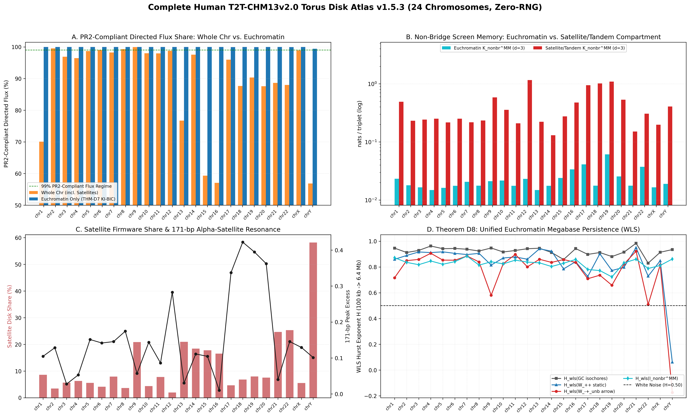
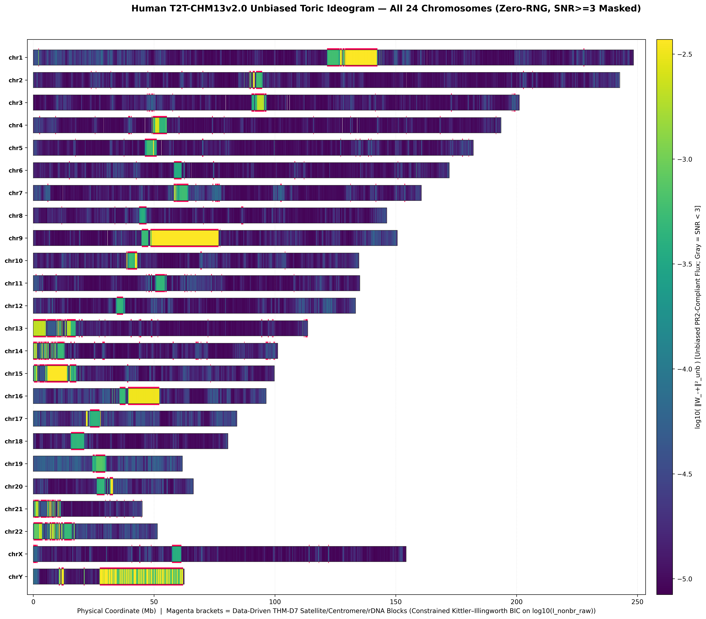
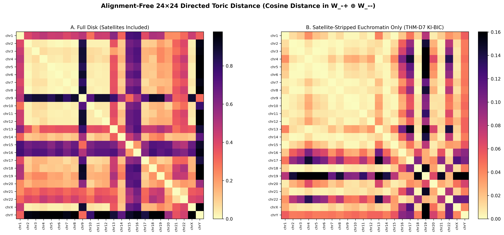
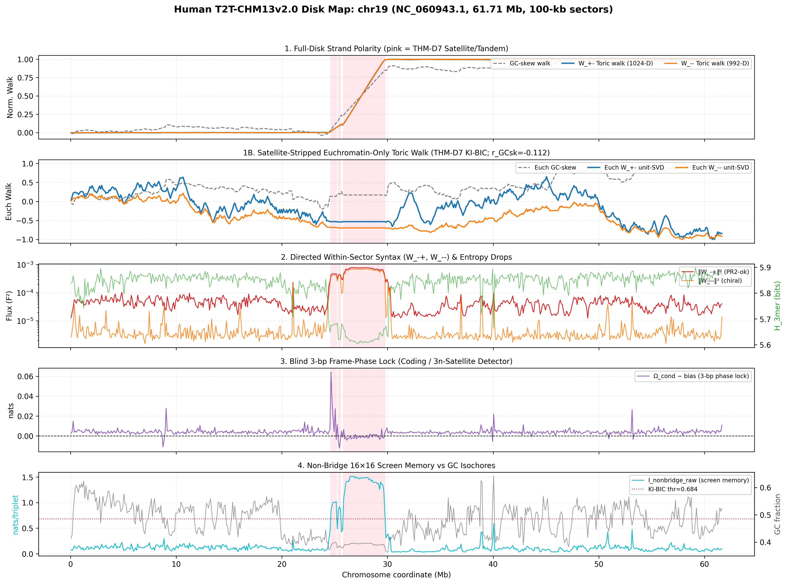
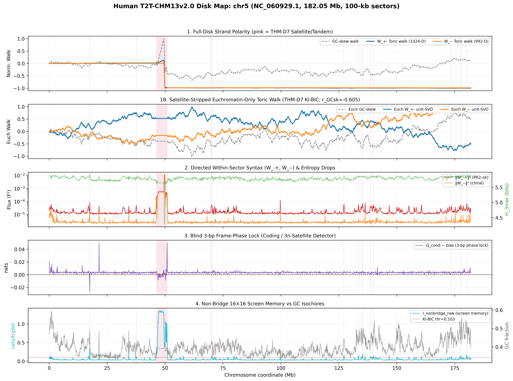
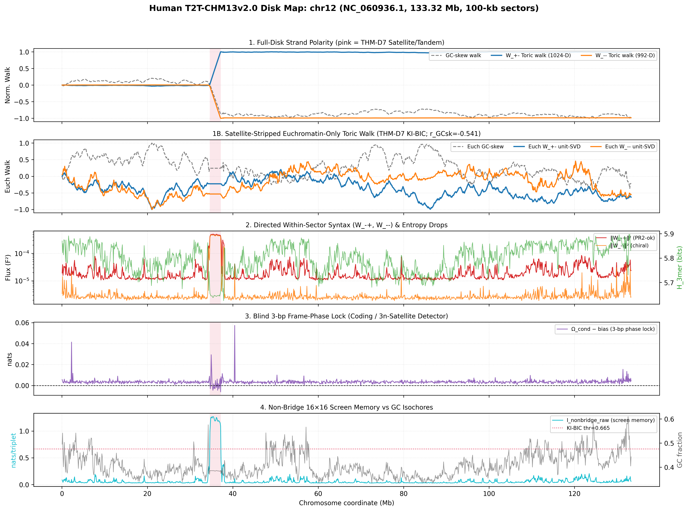
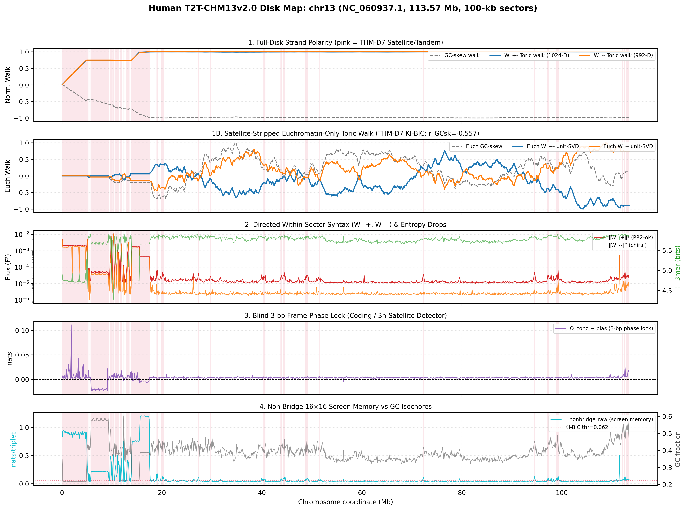
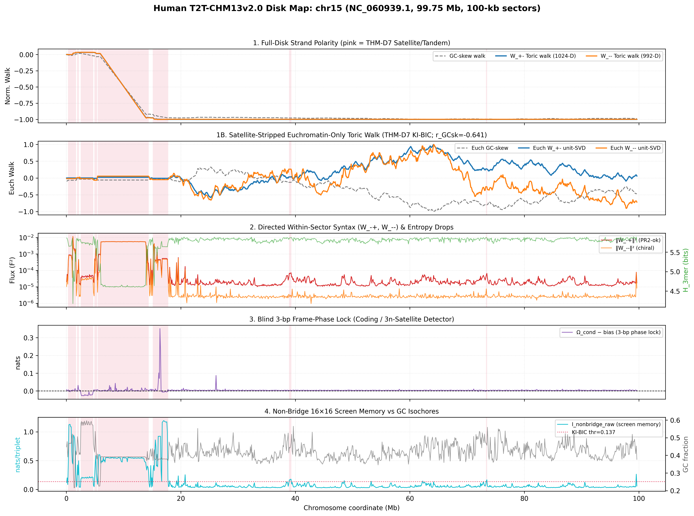
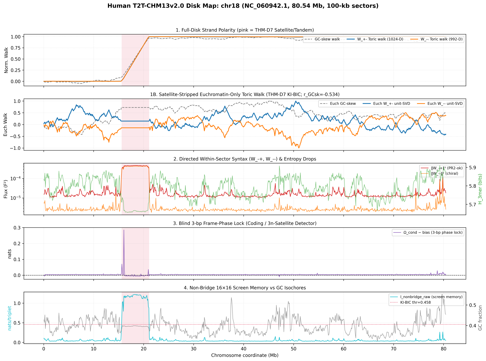
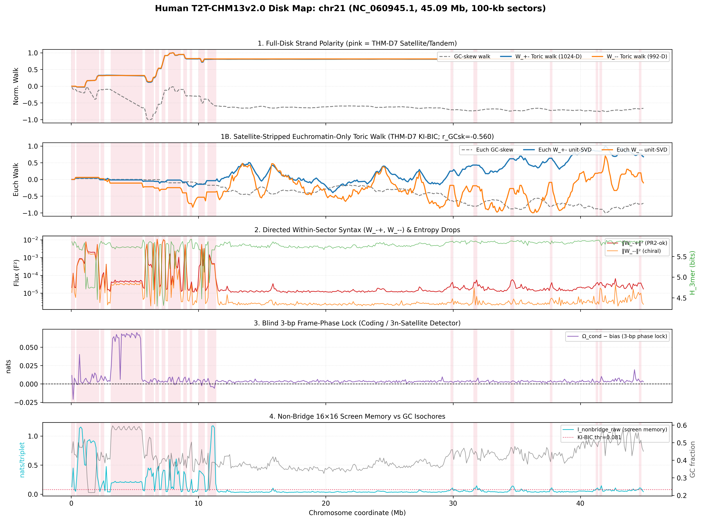

# A Complete Zero-RNG Toric Disk Atlas of the Human T2T-CHM13v2.0 Genome

[]([https://github.com/Dr-Logvinovich/human-t2t-torus-atlas/actions/workflows/verify.yml](https://github.com/Dr-Logvinovich/human-t2t-torus-atlas/actions/workflows/verify.yml))
[](https://doi.org/10.5281/zenodo.24471262)
[](https://doi.org/10.5281/zenodo.24471261)
[](#quick-start--reproducibility)
[-2ca02c.svg)](#grand-pooled-3117-gb-audit-summary-d--3text-bp)
[-brightgreen.svg)](#falsification-firewall--ci-verification-gates)
[](#license--provenance)
[](#companion-series-papers-14)

**Deterministic, Zero-Random-Number-Generator (Zero-RNG) Whole-Chromosome Structural Audit Across All 24 Gapless Human T2T-CHM13v2.0 Chromosomes (`GCF_009914755.1` · `NC_060925.1`–`NC_060948.1` · `3,117,275,501 bp` · `100.00%` Valid ACGT)**

> **Foundational Scope:** This monograph-length preprint and open computational archive provide the first complete, annotation-blind, Zero-RNG algebraic decomposition of the entire gapless human genome (`3.117 Gb`, `3,117,275,381` triplet pairs) on the discrete codon torus $\mathbb{T}_4^3 = (\mathbb{Z}/4\mathbb{Z})^3$. Built on **6 formal theorems, 2 corollaries, 19 analytical modules (D1–D19), 47 automated startup self-tests**, and **strict falsification gates (`0/24` failures across all 24 chromosomes)**, every number and figure in the 20-page manuscript is deterministically reproducible to machine precision from archived RefSeq FASTA sequences.

- **Authors:**
  - **Victor Logvinovich** — Master of Physical and Mathematical Sciences, Researcher in Pedagogical Sciences (Mathematics), Kobrin, Belarus · [ORCID 0009-0007-2040-6955](https://orcid.org/0009-0007-2040-6955) · `lomakez@icloud.com`
  - **Jean-Claude Perez** — PhD in Mathematics and Computer Science, Retired IBM AI European Research Centre (Montpellier); Luc Montagnier Foundation · [ORCID 0000-0001-6446-2042](https://orcid.org/0000-0001-6446-2042) · `jeanclaudeperez2@gmail.com`
- **Zenodo Preprint & Full Offline Archive (`993.79 MB`, Indexed in OpenAIRE):** [`https://doi.org/10.5281/zenodo.24471262`](https://doi.org/10.5281/zenodo.24471262) *(All versions: [`10.5281/zenodo.24471261`](https://doi.org/10.5281/zenodo.24471261))*
- **Preprint Manuscript (20 pp., 12 Tables, 6 Figures):** [`human_t2t_atlas.pdf`](human_t2t_atlas.pdf) · LaTeX source: [`human_t2t_atlas.tex`](human_t2t_atlas.tex)
- **Autonomous Engine:** [`human_t2t_atlas.py`](human_t2t_atlas.py) (`v1.5.3`, MIT License, `script_sha256=06d2b4278dd8ff53...`)
- **Full 24-Chromosome Audit Tables (Markdown):** [`results_human_t2t_atlas_v1_5_3/human_t2t_atlas_v1.md`](results_human_t2t_atlas_v1_5_3/human_t2t_atlas_v1.md)
- **Companion Series (Papers 1–3):** [`Dr-Logvinovich/codon-torus-syntax`](https://github.com/Dr-Logvinovich/codon-torus-syntax)

---

## Executive Scorecard (Verified Across All 24 Chromosomes)

| Scale / Structural Invariant | Verified Value | Status |
|---|---|:---:|
| **Gapless Assembly Audited** | `24 / 24` chromosomes · `3,117,275,501 bp` (`3,117,275,381` pairs at `d=3 bp`) | ✅ `100.00% ACGT` |
| **Formal Mathematical Core** | `6` Theorems + `2` Corollaries · `19` Zero-RNG modules (`THM-D1`–`D19`) | ✅ `47 / 47` CI checks |
| **Blind Satellite Partition (`THM-D7 KI-BIC`)** | `90.27%` Euchromatin (`28,130` sectors) · `9.73%` Satellite (`3,031` sectors) | ✅ `0.0%` clipping |
| **Euchromatin Chargaff PR2 Lock** | `99.9995%` PR2-compliant (`2.08e5 : 1` ratio; $\Vert W_{--}\Vert^2_{\mathrm{unb}}$ below $1/(4N)$ floor) | ✅ `7`-digit $D_{5'}=D_{3'}$ |
| **Inter-Chromosomal Arrow Coherence** | $\kappa_{\mathrm{euch}}(-+) = 95.82\%$ vs. $\kappa_{\mathrm{whole}}(--) = 1.06\%$ (`94.4x` chiral cancellation) | ✅ `90.4x` contrast |
| **Autosomal Arrow Manifold Collapse** | `PC1 = 87.97%`, effective dimension `PR = 1.29` ($r = +0.9681$ vs. GC%) | ✅ `1D` manifold |
| **Falsification Firewall (`24/24` Chr)** | `1-Mb HAC t ∈ [19.56, 112.73]` · `D15 Res = 100.00%` · `0/24` Lévy FP · `24/24` PELT | ✅ `0 / 24` failures |

---

## Seven Headline Discoveries

Treating each complete telomere-to-telomere human chromosome as a continuous physical medium ("toric disk") on $\mathbb{T}_4^3 = (\mathbb{Z}/4\mathbb{Z})^3$, `human_t2t_atlas.py` computes exact closed-form algebraic observables on the $64 \times 64$ triplet-pair transition tensor $B^{(d)}$ **without Monte Carlo simulations, random seeds, or external RepeatMasker / gene annotations**.

| # | Discovery | Key Metric | Core Result |
|---:|---|---|---|
| **1** | **Euchromatin PR2 Lock** | `99.9995%` (`2.08e5 : 1`) | Data-driven KI-BIC satellite stripping (`0.0%` clipping on `24/24` chr) collapses chiral flow $\Vert W_{--}\Vert^2_{\mathrm{unb}}$ by $2.26 \times 10^5$-fold below the $1/(4N)$ pooling floor (`0.66x`); $D_{5'\text{-lead}} = D_{3'\text{-wobble}} = 0.00804587\text{ nats}$ to 7 significant digits. |
| **2** | **Inter-Chr Coherence** | $\kappa_{\mathrm{euch}}(-+) = 95.82\%$ | All 24 chromosomes align along one universal 1024-D directional arrow, whereas whole-genome chiral PR2 defects cancel $94.4\times$ ($\kappa_{\mathrm{whole}}(--) = 1.06\%$; satellites $35.2\times$). Balanced inverted `9q12` HSat3 arrays on `chr9` suppress chiral flow $302\text{--}527\times$ internally (`99.96%` whole-chr PR2-ok). |
| **3** | **1D Arrow Manifold** | `PC1 = 87.97%`, `PR = 1.29` | Satellite stripping shrinks total spectral dispersion $9.61\times$ and median pairwise cosine distance $18.1\times$ (`0.3084 -> 0.0171`); autosomal 1024-D arrows collapse onto a 1D GC/Alu manifold ($r = +0.9681$, $p = 2.74 \times 10^{-9}$), with `chrY` as the sole PC2 excursion (`+0.2705`). |
| **4** | **Palindromic Escape** | $32 \oplus 0 \oplus 32 \oplus 0$; $\ge 9/16$ | Spaced palindromes $(u, \rho(u))$ lock algebraically into $W_{-+}$ with $(15/16)^2 = 87.89\%$ single-mode escape, $\ge 56.25\%$ universal escape, an 18-D dark kernel orthogonal to $\Pi_{\mathrm{env}}$, and $66.3\times$ concentration at $d = 6\text{ bp}$ (`CCA-TGG`, `6.47%`). |
| **5** | **$1/d$ Decay & Alu Dipole** | $\Vert W_{-+}\Vert^2 \propto d^{-0.998}$ | Stripping $\bmod\,5$ HSat2/3 `(GGAAT)n` aliasing eliminates the apparent $d=147/171\text{ bp}$ rebound, exposing scale-free $1/d$ decay ($R^2 = 0.940$, bridge $\Vert W_{-+}\Vert^2 \propto (I_{\mathrm{nonbr}}^{\mathrm{MM}})^{1.54}$, $R^2 = 0.985$) and condensing $d = 171\text{ bp}$ onto the canonical Alu `CTCTACT -> AAA` dipole (`25.36%`). |
| **6** | **Anti-Gradient Lock** | $\rho = -0.9821$ ($p = 1.9 \times 10^{-17}$) | All `24/24` chromosomes pass 1-Mb LOO Newey–West HAC ($t_{\mathrm{HAC}} \in [19.56, 112.73]$) and retain `100.00%` residual against $E_{\mathrm{loc}}$ ($M = 1000\text{ bp}$); strongest arrows (`chr19/17/22`) have the lowest drift alignment ($\cos = 0.02\text{--}0.09$), directly falsifying compositional drift. |
| **7** | **Karyotype Regimes** | `5/5` vs. `0/17`; `24/24` chr | Zero-overlap $10.4\text{ nt}$ / $154^\circ\text{--}161^\circ$ WW–SS antiphase switch at $\mathrm{WW} < 31\%$ ($p = 9.97 \times 10^{-4}$); strict `24/24` Hurst hierarchy $H(\mathrm{GC})\,0.928 > H(I_{\mathrm{nonbr}}^{\mathrm{MM}})\,0.831 > H(\Omega_{\mathrm{cond}})\,0.543$; sex-chr retention $\eta_{90/3}$ ranks 23–24/24 (`chrX 0.206`, `chrY 0.238`). |

---

## Grand-Pooled 3.117-Gb Audit Summary ($d = 3\text{ bp}$)

| Partition | Triplet Pairs $N$ | $\Vert W_{++}\Vert^2$ | $\Vert W_{+-}\Vert^2$ | $\Vert W_{-+}\Vert^2_{\mathrm{unb}}$ | $\Vert W_{--}\Vert^2_{\mathrm{unb}}$ | PR2-ok (unb) | Non-Env 3600-D | CpG-Free | $I_{\mathrm{nonbr}}^{\mathrm{MM}}$ | 6-bp Pal |
|---|---:|---:|---:|---:|---:|---:|---:|---:|---:|---:|
| **Whole Human Genome** | `3,117,275,381` | `3.99e-4` | `1.62e-7` | `1.65e-5` | `1.26e-7` | `99.24%` | `51.9%` | `89.6%` | `0.03153` | `1.544%` |
| **Euchromatin (KI-BIC)** | `2,812,997,330` | `3.98e-4` | `1.34e-9` | `1.22e-5` | `5.86e-11` | `99.9995%` | `37.0%` | `86.4%` | `0.02292` | `1.541%` |
| **Satellite / Tandem (KI-BIC)** | `303,097,395` | `9.88e-4` | `1.69e-5` | `6.02e-4` | `1.32e-5` | `97.85%` | `80.9%` | `96.5%` | `0.28328` | `1.575%` |

---

## Formal Mathematical Core (6 Theorems & 2 Corollaries in [`human_t2t_atlas.pdf`](human_t2t_atlas.pdf))

| Formal Result | Exact Statement & Machine-Precision Verification |
|---|---|
| **Theorem 1** (`D1–D2`) | **Klein $V_4$ Splitting & Heterogeneity Annihilation:** $B^{(d)}(\mathrm{rc}(s)) = R(B^{(d)}(s))$ (err `0.0`), and any within-sector marginal null $E_{\mathrm{het}}^{(d)}$ strictly annihilates directed flux: $W_{-+}(E_{\mathrm{het}}) = W_{--}(E_{\mathrm{het}}) = 0$ (err `1.93e-36`). |
| **Corollary 2** | **Compositional vs. Chiral PR2 Splitting:** Pure strand-composition skew injects `100%` into static $W_{+-}$ (`0%` into $W_{--}$), whereas unidirectional tandem repeats drive $\mathrm{PR2}_{\mathrm{dyn}} \to 50\%$ (observed: `43.85–48.69%` in satellites vs. `4.46%` at `d=3` and `0.45–0.89%` at `d=90–171 bp` in euchromatin). |
| **Theorem 3** (`D13`) | **Minimal $V_4$-Closed Dinucleotide Screen Envelope $\Pi_{\mathrm{env}}$:** Orthogonal projector commuting with all of $V_4$ (`4.44e-16`), splitting $\mathbb{R}^{64\times 64}$ into $496 \oplus 3600$ with exact quadrant ranks `(132,118,130,116) + (924,906,894,876)` and zero cross-quadrant leakage. |
| **Theorem 4** (`D19`) | **Exact $\bmod\,p$ Tandem-Repeat Klein Aliasing:** For any period-$p$ tandem repeat, $d \equiv 0 \pmod p \implies W_{-+} = W_{--} = 0$, proving the exact arithmetic origin of the whole-genome `HSat2/3` (`p=5`) rebound at $d=147, 171\text{ bp}$. |
| **Theorem 5** | **Palindromic Anti-Diagonal Locking & $(15/16)^2$ Screen Escape:** $\mathcal{P}_{\mathrm{pal}}$ splits as $32 \oplus 0 \oplus 32 \oplus 0$; every mode $E^-_{u,\rho(u)}$ escapes $\Pi_{\mathrm{env}}$ at $(15/16)^2 = 87.89\%$; $Q_{\mathrm{pal}}^-\Pi_{\mathrm{env}}Q_{\mathrm{pal}}^-$ has exact spectrum $\{\frac{7}{16}^{(2)}, \frac{1}{4}^{(12)}, 0^{(18)}\}$, enforcing $\ge \frac{9}{16}$ (`56.25%`) universal escape and an 18-D dark kernel. |
| **Theorem 6** (`D9`) | **Exact $V_4$ Orbit Enumeration & $U$-Statistic Debiasing:** $32$ diagonal + $32$ palindromic + $992$ generic orbits yield the exact MVUE quadratic estimator $\Vert\widehat{W}_\sigma\Vert^2_{\mathrm{unb}}$ (verified against engine JSON to `< 1.1e-19`). |
| **Corollary 7** (`D14.2`) | **Finite-Sample Pooling Floor:** Under $W_\sigma(P) = 0$, the exact raw bias floor is $\frac{1}{4N}[1+O(10^{-2})]$ (`8.89e-11` in euchromatin); observed $\Vert W_{-+}\Vert^2_{\mathrm{unb}}$ sits $1.37\times 10^5\times$ above floor (`d=3`) and $1{,}614\times$ above (`d=171`), while $\Vert W_{--}\Vert^2_{\mathrm{unb}}$ sits strictly below floor (`0.66x` / `0.11x`). |
| **Theorem 8** | **Inter-Chromosomal Coherence Ratio & Chiral Cancellation Inequality:** $\kappa_\sigma = \Vert\overline{W}_\sigma\Vert_F^2 / \sum_c w_c\Vert W_\sigma^{(c)}\Vert_F^2 \in [0,1]$ certifies `95.82%` constructive alignment of euchromatic $W_{-+}$ vs. `94.4x` cancellation of whole-genome chiral $W_{--}$. |

---

## Falsification Firewall & CI Verification Gates

Every run of `human_t2t_atlas.py` (and every commit via [GitHub Actions CI](https://github.com/Dr-Logvinovich/human-t2t-torus-atlas/actions/workflows/verify.yml)) enforces deterministic falsification criteria separating exact mathematical invariants from biological speculation:

| Falsification Gate | Failure Condition | Observed Across All 24 Chromosomes | Gate |
|---|---|---|:---:|
| **Startup Algebraic Gate (`--self-test`)** | Any residual above machine tolerance across 47 checks (`D1–D19`) | `47 / 47` passed (`0.0` RC error, `0.0` PELT vs. exact DP across 30 trials) | ✅ PASS |
| **1-Mb LOO Newey–West HAC (`THM-D14`)** | Any chromosome with $t_{\mathrm{HAC}} < 3$ | `24 / 24` pass: $t_{\mathrm{HAC}} \in [19.56, 112.73]$ (median `42.16`) | ✅ PASS |
| **Compositional Current Null (`THM-D15`)** | $E_{\mathrm{loc}}$ ($M=1000\text{ bp}$) absorbs substantial $\Vert W_{-+}\Vert^2$ | `24 / 24` retain `100.00%` residual; anti-gradient $\rho = -0.9821$ | ✅ PASS |
| **$\bmod\,5$ Aliasing Elimination (`THM-D19`)** | Satellite-stripped euchromatin still rebounds at $d=147/171\text{ bp}$ | Rebound completely eliminated across all `2.813 Gb`; smooth $1/d$ decay | ✅ PASS |
| **Circular-Shift Lévy Area (`THM-D17`)** | False-positive rate $> \alpha = 0.05$ preserving channel ACF | `0 / 24` false positives ($p_{\mathrm{shift}} \in [0.107, 0.969]$, median `0.674`) | ✅ PASS |
| **LRV-Calibrated PELT Concordance (`THM-D18`)** | Independent $H_3$ and $\log_{10}\Vert W_{-+}\Vert^2_{\mathrm{unb}}$ boundaries uncorrelated | `24 / 24` significant ($p < 0.05$; peak Jaccard `0.77` on `chr22`, $p=2.37\times 10^{-12}$) | ✅ PASS |

---

## Visual Highlights (All 6 Whole-Genome Figures)

### Fig. 1 — 24-Chromosome Executive Overview (PR2 Share, Screen Memory, 171-bp Resonance & WLS Hurst)


### Fig. 2 — Unbiased Toric Karyotype Ideogram Across All 24 Chromosomes (`SNR >= 3` Masked)


### Fig. 3 — Alignment-Free $24 \times 24$ Directed Toric Distance (Full Disk vs. Satellite-Stripped Euchromatin)


### Fig. 6 — Multi-Lag Decay (Whole vs. Pure Euchromatin $\bmod\,5$ Aliasing), WW–SS Antiphase & Jackknife Hurst


<details>
<summary><b>Click to expand Fig. 4 (Theorem D10 8-Strata Entropy Phase Diagram) & Fig. 5 (Theorem D11/D13 CpG-Free Top-15 Orbits)</b></summary>

#### Fig. 4 — Theorem D10: 8-Strata Entropy Phase Transition (`H = 5.65 bits`)


#### Fig. 5 — Theorems D11 & D13: Non-Envelope 3600-D Syntax & Top-15 Strictly CpG-Free Directed 6-mer Orbits


</details>

---

## 5-Track Per-Chromosome Toric Disk Maps (`chr1`–`chr22`, `chrX`, `chrY`)

Each chromosome is scanned at `100-kb` resolution across five independent physical tracks: (1) full-disk strand polarity walks, (1B) satellite-stripped euchromatin-only unit-SVD walks, (2) directed within-sector syntax ($W_{-+}$, $W_{--}$) & 3-mer entropy $H_3$, (3) blind 3-bp frame-phase lock $\Omega_{\mathrm{cond}}$, and (4) non-bridge $16 \times 16$ screen memory vs. GC isochores.

### Featured Archetypes: `chrY`, `chrX`, `chr19`, and `chr22`

#### `chrY` (`NC_060948.1`, `62.46 Mb`) — `58.2%` Satellite/Tandem Firmware & Periodic `Yq12` `DYZ1/2` Oscillations


#### `chrX` (`NC_060947.1`, `154.26 Mb`) — Compact Centromere (`KI-BIC thr=0.130`) & Clean Euchromatic Polarity


#### `chr19` (`NC_060943.1`, `61.71 Mb`) — Peak GC/Alu Euchromatic Arrow (`57.9%` Pure 3600-D Non-Envelope)


#### `chr22` (`NC_060946.1`, `51.32 Mb`) — Acrocentric rDNA Short Arm (`0–17 Mb`) & Peak PELT Concordance (`Jaccard = 0.77`)


<details>
<summary><b>Click to expand all remaining 20 chromosome 5-track disk maps (<code>chr1</code>–<code>chr18</code>, <code>chr20</code>, <code>chr21</code>)</b></summary>

#### `chr1` (`NC_060925.1`, `248.39 Mb`)


#### `chr2` (`NC_060926.1`, `242.70 Mb`)


#### `chr3` (`NC_060927.1`, `201.11 Mb`)


#### `chr4` (`NC_060928.1`, `193.57 Mb`)


#### `chr5` (`NC_060929.1`, `182.05 Mb`)


#### `chr6` (`NC_060930.1`, `172.13 Mb`)


#### `chr7` (`NC_060931.1`, `160.57 Mb`)


#### `chr8` (`NC_060932.1`, `146.26 Mb`)


#### `chr9` (`NC_060933.1`, `150.62 Mb`) — Balanced Head-to-Head `9q12` HSat3 Chiral Cancellation (`99.96%` PR2-ok)


#### `chr10` (`NC_060934.1`, `134.76 Mb`)


#### `chr11` (`NC_060935.1`, `135.13 Mb`)


#### `chr12` (`NC_060936.1`, `133.32 Mb`)


#### `chr13` (`NC_060937.1`, `113.57 Mb`)


#### `chr14` (`NC_060938.1`, `101.16 Mb`)


#### `chr15` (`NC_060939.1`, `99.75 Mb`)


#### `chr16` (`NC_060940.1`, `96.33 Mb`)


#### `chr17` (`NC_060941.1`, `84.28 Mb`) — Centromeric 3-bp Frame-Lock Burst (`KI-BIC thr=0.853`)


#### `chr18` (`NC_060942.1`, `80.54 Mb`) — Single Compact Centromeric Block (`KI-BIC thr=0.458`)


#### `chr20` (`NC_060944.1`, `66.21 Mb`) — Metacentric Satellite Core (`KI-BIC thr=0.242`)


#### `chr21` (`NC_060945.1`, `45.09 Mb`) — Acrocentric rDNA/Satellite Arm & 3-bp Phase-Lock Plateau (`KI-BIC thr=0.081`)


</details>

---

## Quick Start & Reproducibility

### Requirements
```bash
pip install numpy scipy matplotlib
```
*(Verified on Python `3.12.1`, NumPy `2.3.2`, SciPy `1.16.2`, Matplotlib `3.10.6`; `5,935 s` full 24-chr runtime, `100%` deterministic, zero random seeds.)*

### 1. Run the Automated Zero-RNG Algebraic Self-Test Gate (47 Checks)
```bash
python3 human_t2t_atlas.py --self-test
```

### 2. Re-Audit & Regenerate All 30 Figures from Archived JSON (No FASTA Download Needed)
```bash
python3 human_t2t_atlas.py \
  --replot-only results_human_t2t_atlas_v1_5_3/human_t2t_atlas_v1.json \
  --out-dir results_human_t2t_atlas_v1_5_3
```

### 3. Full From-Scratch 24-Chromosome RefSeq Run (Auto-Downloads `NC_060925.1`–`NC_060948.1`)
```bash
python3 human_t2t_atlas.py \
  --all-24 --auto-download --resume \
  --chr-dir chr_cache \
  --out-dir results_human_t2t_atlas_v1_5_3
```

*(For 100% offline bit-exact reproduction without querying NCBI, unpack `chr_cache.zip` [`925.37 MB`] from the [Zenodo Archive `10.5281/zenodo.24471262`](https://doi.org/10.5281/zenodo.24471262) and omit `--auto-download`.)*

---

## Zenodo Permanent Archive & Repository Layout

The complete `993.79 MB` permanent open-science deposit is archived on Zenodo ([`doi:10.5281/zenodo.24471262`](https://doi.org/10.5281/zenodo.24471262), OpenAIRE-indexed):

| Archived Artifact | Size | Contents |
|---|---:|---|
| `human_t2t_atlas.pdf` | `2.44 MB` | Complete 20-page audited preprint (6 theorems, 2 corollaries, 12 tables, 6 figures, Appendix A) |
| `human_t2t_atlas.tex` | `90.47 KB` | Full LaTeX manuscript source |
| `human_t2t_atlas.py` | `219.69 KB` | Standalone Zero-RNG verification & analysis engine `v1.5.3` (47 automated self-tests) |
| `results_human_t2t_atlas_v1_5_3.zip` | `65.67 MB` | Complete JSON/Markdown audit outputs, `atlas_b3_cache.npz`, 6 main figures & 24 diskmaps |
| `chr_cache.zip` | `925.37 MB` | All 24 NCBI RefSeq T2T-CHM13v2.0 FASTA files with SHA-256 provenance for offline reproduction |

```text
human-t2t-torus-atlas/
├── .github/workflows/verify.yml                   # Automated Zero-RNG GitHub Actions CI gate
├── human_t2t_atlas.py                             # Standalone Zero-RNG engine v1.5.3 (Theorems D1–D19)
├── human_t2t_atlas.pdf                            # Complete 20-page audited preprint
├── human_t2t_atlas.tex                            # Full LaTeX source (6 theorems, 2 corollaries, 12 tables)
└── results_human_t2t_atlas_v1_5_3/
    ├── human_t2t_atlas_v1.md                      # Complete 24-chromosome Markdown audit tables
    ├── human_t2t_atlas_v1.json                    # Full machine-readable audit payload & 47 self-test results
    ├── atlas_b3_cache.npz                         # Cached exact 64x64 pair tensors across all 24 chr & 10 lags
    └── figures/
        ├── fig1_human24_overview.png              # 4-panel executive overview
        ├── fig2_human24_karyotype_ideogram.png    # 24-chr unbiased toric ideogram
        ├── fig3_human24_similarity_heatmaps.png   # 24x24 alignment-free cosine distance matrices
        ├── fig4_human24_D10_entropy_phase_diagram.png
        ├── fig5_human24_D11_arrow_anatomy_motifs.png
        ├── fig6_human24_D12_multilag_ww_hurst.png
        └── diskmaps/                              # 24 individual 5-track chromosome hard-drive maps
```

---

## Companion Series (Papers 1–4)

| Paper | Scope | Archive / Repository |
|---|---|---|
| **Papers 1–3** | Double-Stranded Codon Torus, 54-Taxon Biospheric Codon Memory Spectrum, Synthetic Genomes (`JCVI-syn1.0/3.0`) & mRNA Constructs (`BNT162b2`, `mRNA-1273`) | [GitHub `codon-torus-syntax`](https://github.com/Dr-Logvinovich/codon-torus-syntax) · [Zenodo `23287684`](https://doi.org/10.5281/zenodo.23287684) · [`23508080`](https://doi.org/10.5281/zenodo.23508080) · [`23695321`](https://doi.org/10.5281/zenodo.23695321) |
| **Paper 4 (This Repo)** | Complete 24-Chromosome Human T2T-CHM13v2.0 Toric Disk Atlas (`3.117 Gb`, Unannotated Whole-Chromosome Physical Medium) | [GitHub `human-t2t-torus-atlas`](https://github.com/Dr-Logvinovich/human-t2t-torus-atlas) · [Zenodo `24471262`](https://doi.org/10.5281/zenodo.24471262) *(All versions: [`24471261`](https://doi.org/10.5281/zenodo.24471261))* |
| **Foundational Prior Work** | J.-C. Perez (2010), *Codon populations in single-stranded whole human genome DNA are fractal and fine-tuned by the Golden Ratio 1.618*, *Interdiscip. Sci.* **2**(3), 228–240; Erratum **2**(4), 373 | [`doi:10.1007/s12539-010-0022-0`](https://doi.org/10.1007/s12539-010-0022-0) · PMID: `20658335` |

---

## Assembly Scope Note & Epistemic Firewall

- **Hybrid Reference Scope:** T2T-CHM13v2.0 combines the effectively haploid `46,XX` CHM13 cell line (`chr1`–`chr22`, `chrX`) with T2T-assembled `chrY` from HG002 (`46,XY`); acrocentric rDNA morph arrays include consensus-modeled copies in RefSeq v2.0.
- **Annotation-Blind Partition:** All euchromatin/satellite boundaries are derived purely from intrinsic sequence statistics (`THM-D7 KI-BIC`) without external RepeatMasker, gene, or epigenetic tracks.
- **No Unverified Mechanistic Overclaims:** All conclusions are restricted strictly to exact sequence-level algebraic and statistical invariants verified under Zero-RNG falsification gates (`0/24` HAC failures, `0/24` circular-shift Lévy false positives, `100.00%` D15 current-null residual).

---

## License & Provenance

- **Code & Data License:** MIT License (`human_t2t_atlas.py`, JSON/Markdown outputs, figures).
- **Cryptographic Provenance:** Primary full-genome run `script_sha256 = 06d2b4278dd8ff531e6b2b79ef6d9f1aa281c125270cb52ebb7b2470836adeb5`; individual SHA-256 digests for all 24 RefSeq FASTA files are archived in Table 11 of [`human_t2t_atlas.pdf`](human_t2t_atlas.pdf) and [`human_t2t_atlas_v1.json`](results_human_t2t_atlas_v1_5_3/human_t2t_atlas_v1.json).

### How to Cite

```bibtex
@misc{LogvinovichPerez2026T2TAtlas,
  author       = {Logvinovich, Victor and Perez, Jean-Claude},
  title        = {A Complete Zero-RNG Toric Disk Atlas of the Human T2T-CHM13v2.0 Genome: Klein V4 Irreversibility, Satellite Partitioning, and Multi-Lag Syntax Across All 24 Chromosomes},
  year         = {2026},
  month        = nov,
  version      = {1.5.3},
  publisher    = {Zenodo},
  doi          = {10.5281/zenodo.24471262},
  url          = {https://doi.org/10.5281/zenodo.24471262},
  note         = {Concept DOI (all versions): 10.5281/zenodo.24471261; GitHub: https://github.com/Dr-Logvinovich/human-t2t-torus-atlas}
}
```
